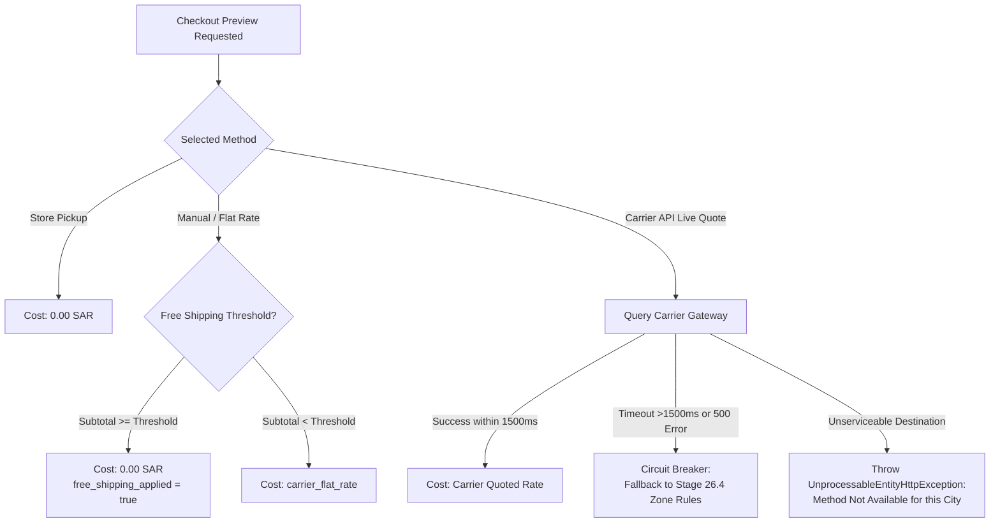

# Batch S2-03: Pricing Policy & Snapshot Design Report

> **Batch ID:** `S2-03-pricing-policy`  
> **Status:** `COMPLETE`  
> **Execution Date:** 2026-10-27  

---

## 1. Executive Summary

This report defines the complete mathematical, financial, and snapshot integrity policies governing customer shipping charges, free shipping promotions, carrier actual costs, and marketplace subsidies for DIYAR Shipping V2.

---

## 2. Financial Separation: Customer Price vs. Carrier Cost

```
┌──────────────────────────────────────────────┐
│             CHECKOUT / ORDER                 │
│                                              │
│  vendor_orders.shipping_cost                 │
│  (Authoritative Customer-Facing Charge)      │
│  - Examples: 25.00 SAR, 0.00 SAR (Free)      │
└──────────────────────┬───────────────────────┘
                       │
                       │ Handled independently
                       ▼
┌──────────────────────────────────────────────┐
│            CARRIER DISPATCH                  │
│                                              │
│  carrier_shipments.carrier_actual_cost       │
│  (Billed by Carrier to DIYAR Account)        │
│  - Example: 32.50 SAR                        │
└──────────────────────┬───────────────────────┘
                       │
                       ▼
┌──────────────────────────────────────────────┐
│         LOGISTICS MARGIN / SUBSIDY           │
│                                              │
│  Diff = Customer Fee (25) - Carrier Cost (32.50)
│  = -7.50 SAR (DIYAR Platform Expense)        │
└──────────────────────────────────────────────┘
```

### Invariants Established:
1. **Zero Retroactive Mutation:** A change in carrier pricing or live quotes after checkout **MUST NEVER** alter an accepted order's `shipping_cost` or `grand_total`.
2. **Vendor Settlement Isolation:** Vendor payout calculations use:
   $$\text{vendor\_total} = \text{subtotal} + \text{shipping\_cost} + \text{assembly} + \text{vat} - \text{discounts}$$
   Carrier transport costs billed to DIYAR do not silently deduct from vendor balances unless explicitly contracted under a seller-paid shipping program.

---

## 3. Quoting Precedence & Fallback Rules



### Precedence Matrix:
1. **Free Shipping Coupons / Promotions:** If a valid coupon provides free shipping, `vendor_orders.shipping_cost = 0.00` and `shipping_discount_amount` records the discounted fee. The carrier still charges DIYAR; DIYAR absorbs the cost as marketing expenditure.
2. **Circuit Breaker Fallback:** If the external carrier quote API does not respond within **1500ms**, the request fails open to the Stage 26.4 internal zone/tier rules table, preventing checkout abandonment.

---

## 4. Three-Face Review

- **Face 1 (Principal Software Engineer):** Verified BCMath monetary precision. All monetary fields maintain `decimal(12, 2)` string scalars using `bcadd`, `bcsub`, and `bcmul` to prevent floating-point drift.
- **Face 2 (QA/DevOps/Performance):** Verified timeout boundaries. Synchronous carrier quotes during checkout are bounded at 1.5 seconds. If exceeded, circuit breaker drops to local database rate lookup.
- **Face 3 (Security/Bug Bounty):** Verified price tampering prevention. Shipping costs are re-calculated and verified server-side inside [`OrderCreationService.php`](file:///c:/Users/APL%20TECH/OneDrive/Documents/Web/Work/Hamid/project/diyar-marketplace/backend/app/Domains/Orders/Services/OrderCreationService.php). Client cannot inject arbitrary shipping fees.

---

## 5. Exit Gate Decision

**BATCH S2-03 COMPLETE — PROCEEDING TO S2-04 (Domain Persistence & Schema Migrations)**
