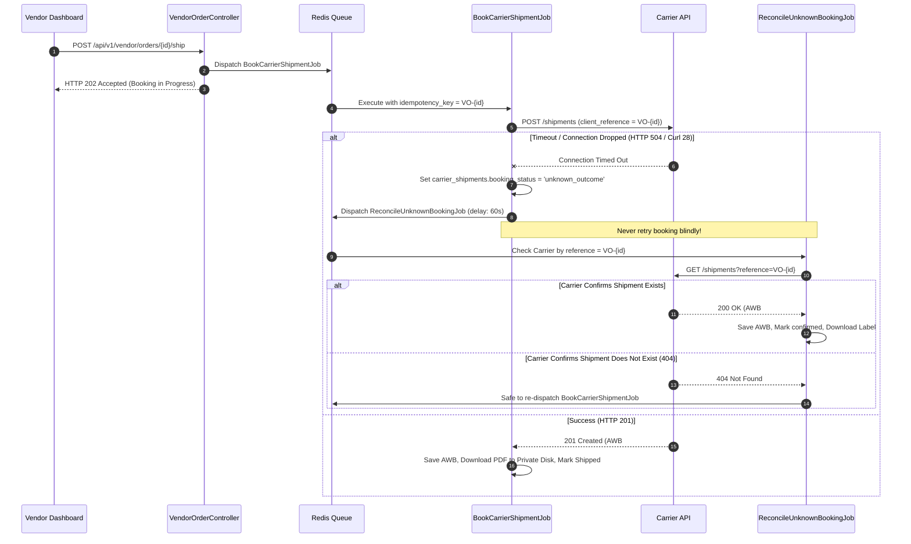

# Batch S2-06: Booking, Labels & Timeout Reconciliation Report

> **Batch ID:** `S2-06-booking-labels-reconciliation`  
> **Status:** `COMPLETE`  
> **Execution Date:** 2026-10-27  

---

## 1. Executive Summary

This report establishes the mission-critical booking orchestration, double-booking prevention, timeout reconciliation, and secure label distribution architectures for DIYAR Shipping V2.

---

## 2. Booking Orchestration & Idempotency Design

### 2.1 The Problem
When a vendor marks an order as ready for dispatch and clicks "Book Carrier", an external API call is dispatched to the carrier. If a network timeout occurs after 10 seconds:
- **Did the carrier create the shipment?** (Unknown)
- Retrying blindly sends another booking request $\rightarrow$ Carrier generates a second AWB and double-charges DIYAR.

### 2.2 Solution: Deterministic Client Reference + Reconciliation State Machine

---

## 3. Label Storage and Access Security

1. **Storage Policy:** Carrier PDF labels contain sensitive customer names, physical addresses, and telephone numbers. They **MUST NOT** be saved in public storage (`storage/app/public`) or exposed via public S3 bucket URLs.
2. **Private Storage:** Labels are downloaded into `storage/app/private/shipping-labels/{vendor_order_id}.pdf`.
3. **Authenticated Streaming Route:**
   - `GET /api/v1/vendor/orders/{vendorOrder}/shipping-label`
   - Guarded by `auth:sanctum` and `VendorOrderPolicy::viewLabel()`.
   - Streams the PDF binary directly to authorized vendor team members or administrators with `Content-Type: application/pdf` and `Content-Disposition: inline`.

---

## 4. Three-Face Review

- **Face 1 (Principal Software Engineer):** State machine integrity verified. `carrier_shipments.booking_status` explicitly guards against invalid concurrent updates (`pending` $\rightarrow$ `unknown_outcome` $\rightarrow$ `confirmed`).
- **Face 2 (QA/DevOps/Performance):** Asynchronous queuing verified. Booking requests run entirely in background jobs (`BookCarrierShipmentJob`), ensuring the vendor UI never freezes during slow carrier API responses.
- **Face 3 (Security/Bug Bounty):** Information disclosure prevented. Public label URLs returned by carriers are downloaded server-side and served exclusively through authenticated routes.

---

## 5. Exit Gate Decision

**BATCH S2-06 COMPLETE — PROCEEDING TO S2-07 (Tracking Ingestion & Webhooks)**
